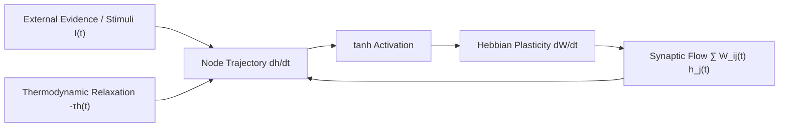

# Aethelnet Core: Continuous-Time LGNN & Headless Python SDK

[](LICENSE)
[](https://www.python.org/downloads/)
[](https://aethelburg.network)
[](https://github.com/aethelnet/aethelnet-core/actions/workflows/tests.yml)

**Aethelnet Core** is the mathematical foundation and client SDK for the Aethelnet Cognitive Network. It provides:
1. **`AethelnetClient`**: Zero-dependency headless Python client to interact with live production nodes, evidentiary multigraph ledgers, and on-chain notarization contracts.
2. **`LiquidGraph`**: Continuous-time topological state machine governed by Ordinary Differential Equations (ODEs) and Hebbian plasticity, replacing discrete-time static weight matrices with dynamical physical systems.
3. **Tripartite Duality**: Unified mathematical kernel operating identically across forensic evidentiary resolution, spatial active inference (ARC-AGI-3), and continuous financial state-space modeling.

---

## 1. Quickstart: Headless Python SDK (`AethelnetClient`)

The headless client provides full programmatic access to any local or remote Aethelnet node (`https://aethelburg.network` or `http://localhost:8000`):

```bash
pip install git+https://github.com/aethelnet/aethelnet-core.git
```

```python
from aethelnet import AethelnetClient

# Connect to the canonical public node or local development instance
client = AethelnetClient(base_url="https://aethelburg.network")

# 1. Inspect registered investigations and evidentiary schemas
cases = client.list_investigations()
print("Active Cases:", [c["app_id"] for c in cases])

# 2. Query mathematical dissonance & contradiction verdicts
conflicts = client.get_conflicts("project_echo")
for c in conflicts[:3]:
    print(f"[{c['verdict_code']}] {c['source']} <-> {c['target']}: {c['verdict']}")

# 3. Scan for duplicate entities & honorific aliases
candidates = client.get_dedup_candidates("project_echo", min_confidence=0.90)
for dup in candidates[:5]:
    print(f"Candidate: '{dup['duplicate_label']}' -> Canonical '{dup['primary_label']}' ({dup['confidence'] * 100:.1f}%)")

# 4. Compute canonical Merkle-style SHA-256 state root
state_data = client.get_case_state_root("project_echo")
print(f"State Root: {state_data['state_root']}")
print(f"Entities: {state_data['node_count']}, Claims: {state_data['edge_count']}")

# 5. Notarize case state root on-chain via ERC-4337 Account Abstraction
notarization = client.notarize_case("project_echo")
print(f"On-Chain Tx Hash: {notarization.get('tx_hash')}")
```

### Custom Investigation & Idempotent Claim Ingestion

```python
# Create a specialized investigation schema
client.create_investigation(
    app_id="whistleblower_audit",
    name="Corporate Supply Chain Provenance",
    domain="human_rights_due_diligence",
    description="Cross-referencing corporate audit statements against verified investigative findings.",
    entities=["mine_operator", "smelter", "battery_oem", "auditor"],
    relations=["sources_from", "certifies_clean", "denies_violations"],
    conflict_rules=[{
        "rule_id": "audit_vs_whistleblower",
        "name": "Audit vs Whistleblower Contradiction",
        "conflicting_relations": ["certifies_clean", "denies_violations"],
        "severity": "critical",
        "description": "Internal certification directly contradicts verified whistleblower evidence."
    }]
)

# Insert verifiable claim backed by verbatim source citations (Idempotent SHA-256 Hashing)
client.insert_claim(
    app_id="whistleblower_audit",
    source="Mine_Alpha",
    target="OEM_Battery_GmbH",
    relation_type="certifies_clean",
    evidence_quote="Third-party audit certificate ISO-14001 issued June 2024.",
    source_doc_id="Audit_Doc_442"
)
```

---

## 2. Mathematical Foundation: Continuous-Time LGNN Physics

Unlike conventional static Graph Neural Networks (GNNs) that rely on discrete synchronous message passing $h_i^{(l+1)} = \sigma(W h_i^{(l)})$, Aethelnet's `LiquidGraph` models information as continuous physical flows governed by non-linear Ordinary Differential Equations:

$$ \frac{dh_i(t)}{dt} = -\tau_i h_i(t) + \tanh\left( \sum_{j \in \mathcal{N}(i)} W_{ij}(t) h_j(t) + I_i(t) \right) $$

Where:
* **$\tau_i$**: Thermodynamic decay / relaxation rate of concept node $i$.
* **$W_{ij}(t)$**: Dynamic synaptic coupling between nodes $i$ and $j$.
* **$I_i(t)$**: External sensory stimuli / evidentiary inputs.
* **$h_i(t) \in \mathbb{R}^d$**: Continuous latent semantic trajectory.



### Continuous Hebbian Plasticity & Topological Sparsity

Synaptic weights evolve continuously based on synchronous co-activation and decay:

$$ \frac{dW_{ij}(t)}{dt} = \eta \cdot \left( h_i(t) \cdot h_j(t) \right) - \gamma \cdot W_{ij}(t) $$

* **$\eta$**: Hebbian learning rate (strengthens actively co-firing semantic pathways).
* **$\gamma$**: Synaptic decay rate (prunes stale connections to maintain sparsity).

### Running Pure Liquid Graph ODE Simulations

```python
import torch
from aethelnet.liquid_graph import LiquidGraph

# Initialize a continuous cognitive graph
graph = LiquidGraph(
    hidden_dim=256,
    resonance_threshold=0.60,
    decay_rate=0.05,
    tether_strength=0.50
)

# Register semantic concept nodes
graph.add_node("artifact_b13897", embedding=torch.randn(256), is_axiom=True)
graph.add_node("colonial_officer", embedding=torch.randn(256))

# Simulate continuous trajectory over virtual time t
t_span = torch.linspace(0.0, 2.0, 50)
trajectory = graph.forward_trajectory(t_span)
```

---

## 3. Tripartite Mathematical Duality

Aethelnet's mathematical architecture is domain-invariant:

1. **Evidentiary Forensic Multigraph** ([`packages/aethelnet-node`](../aethelnet-node/)):
   Nodes are entities, edges are historical assertions. Contradictions resolve through 4-tier epistemic weighting and continuous dissonance minimization.
2. **Autonomous Spatial Active Inference** ([`kaggle_arc/`](../../kaggle_arc/)):
   Nodes are segmented visual objects, edges are spatial affordances. Obstacles, pushable crates, and goal slots form an induced causal graph solved via BFS/A* and Sokoban corner-deadlock avoidance.
3. **Continuous Market Dynamics** ([`sovereign_trading_engine/`](../../sovereign_trading_engine/)):
   Assets are nodes coupled by cross-sectional liquidity spillover. The 1D-ODE $\tau=25$ extracts structural trend momentum while filtering microstructural high-frequency noise.

---

## Installation & Verification

```bash
# Clone repository
git clone https://github.com/aethelnet/aethelnet-core.git
cd aethelnet-core

# Install in editable mode with test dependencies
pip install -e ".[dev]"

# Run test suite
pytest tests/ -v
```

*License: GNU Affero General Public License v3.0 (AGPL-3.0)*
